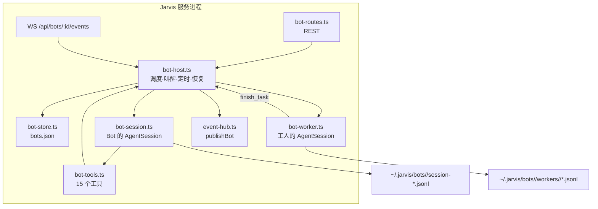
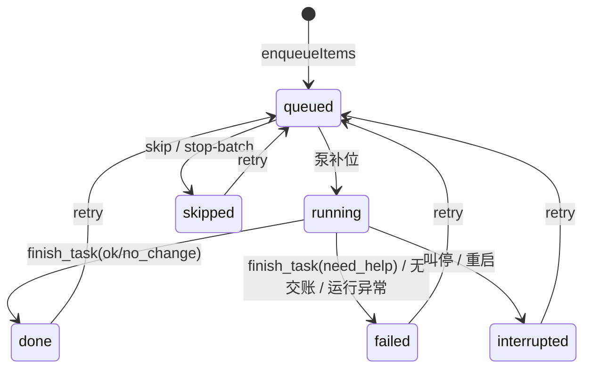
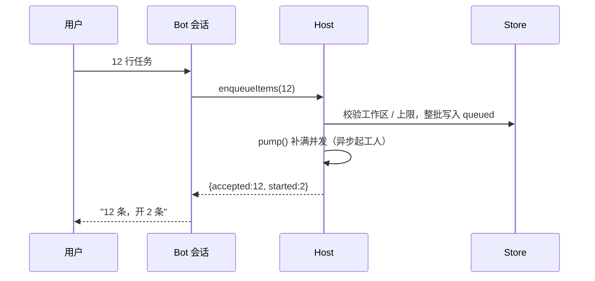
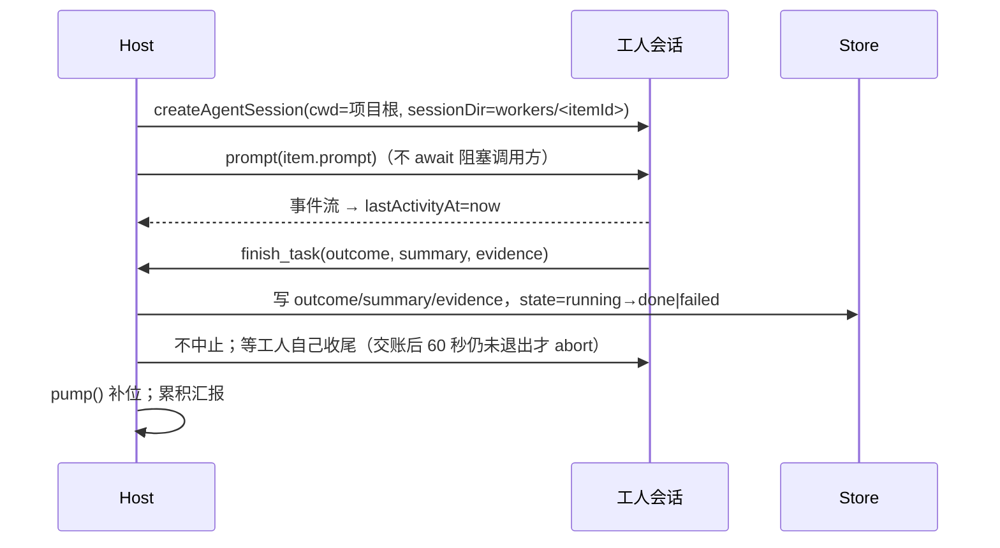
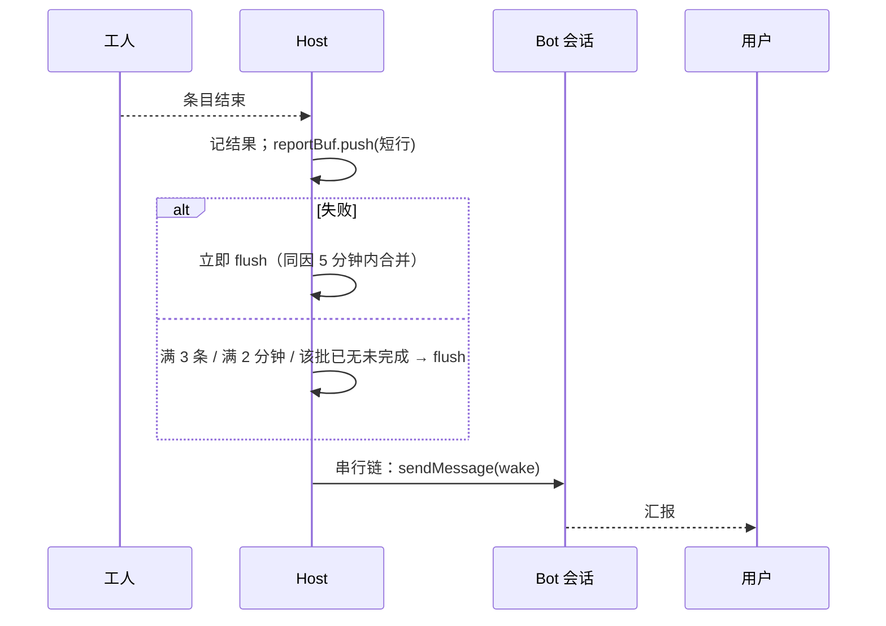
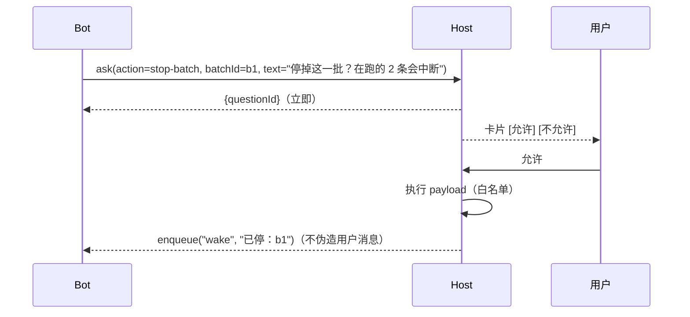

# Bot 架构与实现方案

产品定义见 `docs/bot-product.md`。本文是落地方案，替代 `docs/bots.md` 中与之冲突的规则（差异见最后一节）。

## 1. 基本取舍

| # | 决策 | 理由 | 代价 |
| --- | --- | --- | --- |
| 1 | Bot 与工人都是**进程内 AgentSession**，不派生 CLI 子进程 | `session.prompt()` 的 resolve 就是一轮结束，`abort()` 就是取消；不需要结果行协议，不需要拼 stdout，不需要猜会话文件名 | Jarvis 退出即全部中断；与"关掉就不跑"的产品约定一致 |
| 2 | **队列自驱**：工人一结束，主机立刻补位开工，模型不逐条点开工 | 12 条逐条决策 = 12 次模型回合；自驱后一批只需 1～3 回合 | 模型失去"逐条调度"感；用暂停/叫停/重试保留控制 |
| 3 | **状态只由主机写**，模型没有"标记完成"的工具 | 模型说完成而队列还有 7 条，是最难排查的错 | 模型只能通过工具改队列，不能改事实 |
| 4 | **Bot 无文件与命令能力**，活只在工人里做 | Bot 会话没有 `workspaceId`，产物无 diff、无项目归属 | Bot 查情况要靠工具摘要，不能自己读文件 |
| 5 | 交账用 **`finish_task` 工具**，不用自然语言约定 | 结构化、可校验、可即时终止工人 | 工人必须调用它，否则算失败 |
| 6 | 提问是**卡片 + 主机白名单动作**，不是自由文本 | 自由文本匹配会静默失败，人以为停了其实没停 | 只支持三种动作 |
| 7 | 汇报**按批**：单条只动看板 | 12 条逐条汇报比不汇报更烦 | 单条完成不即时可见（看板仍即时） |
| 8 | 传输**新增 bot 通道**，不复用 `SessionRef` | `EventHub` 的键是 `workspaceId:sessionId`，WS 路由要求两个 UUID | 多一个 hub map、一个路由、一个 hook |
| 9 | 持久化用**单个 JSON + 原子替换** | 与 `settings.json` / 注意力文件同范式；量级是几十条 | 不能多进程写；单进程串行化即可 |
| 10 | 笔记用内联扩展在 `before_agent_start` 里返回 `systemPrompt` | 每轮都拿到最新笔记，不改转录、不重建会话、不丢队列 | 笔记一变，那一轮丢一次 prompt cache |
| 11 | 主机持有**单轮锁**，所有用户消息与唤醒串行进入会话 | 同 tick 两次 `prompt()` 会撞上 Pi 的 "already processing"，并误发一次 `agent_settled` | 唤醒要等当前回合结束；用户消息用 `steer` 插队 |

## 2. 进程与模块



| 文件 | 职责 | 规模估计 |
| --- | --- | --- |
| `src/shared/bot.ts` | 类型、上限常量、状态派生函数 | 150 行 |
| `src/server/bot-store.ts` | 读写 `bots.json`、增删改、串行化写入、损坏恢复 | 300 行 |
| `src/server/bot-host.ts` | 队列泵、并发、叫醒合并、停住检测、定时、重启恢复、关闭 | 450 行 |
| `src/server/bot-session.ts` | 建/开 Bot 会话，装载工具与内联扩展 | 150 行 |
| `src/server/bot-extension.ts` | 内联扩展：`before_agent_start` 注入笔记、`sendMessage` 送唤醒、`agent_settled` 回调 | 120 行 |
| `src/server/bot-tools.ts` | 工具定义（只做参数校验后调 host） | 250 行 |
| `src/server/bot-worker.ts` | 起工人会话、挂事件、`finish_task`、中止、取转录 | 220 行 |
| `src/server/bot-routes.ts` | REST 路由 + zod | 200 行 |
| `src/server/bot-projection.ts` | 把 Pi 会话条目投影成 Bot 页/工人页的条目 | 120 行 |
| `src/client/hooks/use-bot-stream.ts` | Bot 页的流与分页 | 200 行 |
| `src/client/components/bot-*.tsx` | 侧栏分组、页面、看板、条目列表、问题卡、日志页 | 500 行 |
| `src/server/event-hub.ts` | 追加 `addBot` / `publishBot` / bot 序号表 | +40 行 |
| `src/server/session-service.ts` | 暴露 `modelRuntime()` 给 host 复用 | +3 行 |
| `src/server/app.ts` | 注册路由、bot WS、启动/关闭 host | +40 行 |

## 3. 数据模型

```ts
// src/shared/bot.ts
export const BOT_LIMITS = {
  name: 40,
  job: 200,
  prompt: 8000,
  summary: 1000,
  evidence: 2000,
  notes: 8000,
  enqueueBatch: 20,
  unfinishedPerBot: 40,
  concurrencyMin: 1,
  concurrencyMax: 4,
  quietMsMin: 60_000,
  routineEveryMin: 5 * 60_000,
  inspectExcerpt: 4000,
} as const;

export type BotItemState =
  | "queued" | "running" | "done" | "failed" | "skipped" | "interrupted";

export type BotItemOutcome = "ok" | "need_help" | "no_change";

export interface BotItem {
  id: string;
  botId: string;
  batchId: string;
  /** 入队时从第一条 prompt 取，可被模型覆盖。 */
  title: string;
  /** 目标项目，来自已登记工作区。 */
  workspaceId: string;
  /** 给工人的任务正文。 */
  prompt: string;
  state: BotItemState;
  outcome?: BotItemOutcome;
  /** 工人交账的一句话结论，超长截断。 */
  summary?: string;
  evidence?: string;
  error?: string;
  attempt: number;
  createdAt: string;
  startedAt?: string;
  endedAt?: string;
  /** 工人最近一次任何事件的时刻；用于停住判定。 */
  lastActivityAt?: string;
  /** 已经发过一次"停住"提示的时刻，避免重复提醒。 */
  stallNoticedAt?: string;
  /** 工人 Pi 会话文件，点开日志时读它。 */
  workerFile?: string;
}

export interface BotRecord {
  id: string;
  name: string;
  /** 职责，最多 200 字。 */
  job: string;
  createdAt: string;
  /** Bot 自己的 Pi 会话文件。 */
  sessionFile?: string;
  /** 每次写笔记 +1，内联扩展据此判断要不要换提示词。 */
  notesVersion: number;
}

export interface BotQuestion {
  id: string;
  botId: string;
  /** 主机能执行的动作，只有三种。 */
  action: "stop-batch" | "skip-batch" | "remember-rule";
  /** stop-batch / skip-batch 用 batchId；remember-rule 用 text。 */
  payload: { batchId?: string; text?: string };
  /** 对话里展示的那一句。 */
  text: string;
  createdAt: string;
  resolvedAt?: string;
  resolution?: "accepted" | "rejected";
}

export interface BotRoutine {
  id: string;
  botId: string;
  text: string;
  kind: "at" | "every";
  at?: string;
  everyMs?: number;
  nextRunAt: string;
  lastRunAt?: string;
}
```

落盘：

```text
~/.jarvis/bots.json                     # 上面四类对象的全部数据 + version
~/.jarvis/bots/<botId>/session-*.jsonl  # Bot 对话（Pi 会话）
~/.jarvis/bots/<botId>/notes.md         # 笔记
~/.jarvis/bots/<botId>/workers/<itemId>/session-*.jsonl  # 工人转录
```

`bots.json` 结构：

```ts
interface BotStoreFile {
  version: 1;
  bots: BotRecord[];
  items: BotItem[];
  questions: BotQuestion[];
  routines: BotRoutine[];
  /** 批次暂停开关；不建状态机，只挡补位。 */
  pausedBatches: string[];
  settings: { concurrency: number; quietMs: number };
}
```

写入：所有变更走 `BotStore.mutate(fn)`，内部用 `operationChain` 串行，改副本 → `writeWithBackup(path, JSON.stringify(...))`。启动时 `readJsonRecovering`，解析失败就用备份并记一条警告。

## 4. 状态机

### 条目



- 只有 `queued` 会被泵选中。
- `done` 之后 `retry` 允许（用户想再跑一遍），此时 `attempt + 1`，`summary/error` 清空。
- `failed` 的 `error` 是给人看的一句话，不塞堆栈。

### Bot 状态（派生，不落盘）

```ts
type BotStatus = "working" | "failed" | "paused" | "idle";

function botStatus(items: BotItem[], paused: Set<string>): BotStatus {
  const open = items.filter((i) => i.state === "running" || i.state === "queued");
  if (open.some((i) => i.state === "running")) return "working";
  if (open.length > 0) return open.every((i) => paused.has(i.batchId)) ? "paused" : "working";
  if (items.some((i) => i.state === "failed" || i.state === "interrupted")) return "failed";
  return "idle";
}
```

- 未决问题不改变状态，只作为一个徽标 `待答`。
- 叫停整批后条目仍在，状态照上面的规则算（可能仍是 `failed`）。

### 定时

`at` 触发后删除；`every` 触发后把 `nextRunAt` 推到下一个未来时刻（不补跑）。

## 5. 核心流程

### 5.1 入队（工具调用）



要点：

- 工具**不等待**工人。`pump()` 只负责 `void startWorker(item)`。
- 工作区不存在、超上限 → 整批拒绝，一条都不写。
- 未完成条目超过 `unfinishedPerBot` 也整批拒绝。

### 5.2 工人生命周期



没有 `finish_task` 时，`prompt()` 结束后读最后一条 assistant 文本：

- 文本非空 → `failed`，`error = "没有交账"`，`summary` 保留那段文本的前 1000 字（人能看到它说了什么）。
- 文本为空 → `failed`，`error = "没有交账"`。
- 抛出异常 → `failed`，`error = 错误摘要`。

**终态只写一次。** `finish_task` 写入后，条目已不是 `running`；之后不管 `prompt()` 是正常 resolve、报错还是被 abort，都不再改写结果。这条规则同时覆盖 60 秒兜底 abort 的时序：先记录的是权威。

### 5.3 叫醒与汇报

所有进入会话的轮次（用户消息、叫醒、问题答复）都走 `BotRunner` 的串行链，保证同一时刻只有一个回合在跑：

```ts
private serial: Promise<void> = Promise.resolve();

private enqueue(kind: "user" | "wake", text: string): void {
  if (kind === "wake") { this.wakeBuf.push(text); return; }
  this.serial = this.serial.then(() => this.deliverUser(text)).catch((error) => this.noteTurnFailure(error));
}

private async deliverUser(text: string): Promise<void> {
  await this.session.isStreaming ? this.session.steer(text) : this.session.prompt(text);
}

/** 叫醒只在空闲时发；忙时留在 wakeBuf，由 agent_settled 回调再提交。 */
private async flushWake(): Promise<void> {
  if (this.wakeBuf.length === 0) return;
  const text = this.mergeWake(this.wakeBuf.splice(0));
  this.serial = this.serial.then(async () => {
    await this.sendWake(text);      // sendMessage({triggerTurn:true})
    await this.waitForSettle();     // 内联扩展的 agent_settled → resolve
  }).catch((error) => this.noteTurnFailure(error));
}
```

叫醒不用 `prompt`：它发一条 `customType: "jarvis.wake"` 的自定义消息并触发一轮，然后等 `agent_settled`。串行链等的是**轮次结束**，不是消息发出。

```ts
await sendWake(text);   // pi.sendMessage({customType:"jarvis.wake", display:false, content:text}, {triggerTurn:true})
await waitForSettle();  // sendWake 后等 agent_settled，而不是等消息发出
```

`flushWake` 的失败回退：进来先看 `isStreaming`；若为 true（上一个回合的队列还没排空），**不消耗** `wakeBuf`，直接返回。`agent_settled` 回调每次都会调 `flushWake`，所以下一次自然重试；不另设定时器。



短行格式固定，不附带工具过程：

```text
在跑 1 · 待做 7 · 失败 0
结束 item-3 成功：<summary>
```

失败单独走：

- 一条 `failed` 立刻 flush，不等 3 条。
- 同一 `error` 文本在 5 分钟内只报一次，后面的折成 `同类 3 条失败`。
- 没有未完成条目时，最后一次 flush 带总数：`12 条：9 完成、2 失败、1 跳过`。

用户消息与叫醒的关系：

- 用户消息走同一条串行链；轮到它时若 Bot 正在跑，用 `session.steer()` 插进去，不排到汇报后面。
- 叫醒先入 `wakeBuf`，轮到时合并成一条消息。
- `reportBuf` 超过 8 行时只保留最后 8 行，前面的折成 `另有 N 条结束`。合并后的叫醒最多 8 行，其余折成 `另有 N 条`。
- 串行链会让用户消息排在**已开始的**回合后面；这是唯一保证不撞 Pi 单飞限制的方式。

### 5.4 停住

每 30 秒扫一次 `running` 条目：

- `now - lastActivityAt > quietMs` → 打 `stallNoticedAt`，看板标「N 分钟无输出」，**不叫醒、不杀**。
- `now - lastActivityAt > 2 × quietMs` 且 `stallNoticedAt` 早于一个 `quietMs` → 叫醒一次，带最后 80 行摘要；之后每 2×quietMs 最多再叫一次。
- 进程仍在跑就不改状态。

### 5.5 提问与授权



答复是界面动作，不是用户打的字，所以走叫醒通道；它在时间线上表现为 Bot 的一轮回复，而不是一条用户消息。

- 未决期间不执行 payload；已在跑的继续。
- 问题被拒绝或用户删除 Bot，`payload` 丢弃。
- `remember-rule` 接受后由主机写 `notes.md`，不在模型回合里写。

### 5.6 定时与重启

```text
启动时：
  1. items: running → interrupted（error="Jarvis 关闭时被中断"）
  2. 打开每个 Bot 的会话文件；没有就新建
  3. 若有 interrupted / failed，叫醒一次，带上清单
  4. routines:
       nextRunAt > now          → 不动
       now - nextRunAt <= 1h    → 触发一次
       否则                     → 直接推到下一个未来时刻（记录 lastRunAt=null）
  5. 叫停过的批次没有 queued 条目，泵不会再选它；用户点重试才会重新入队
```

关闭时：`abort()` 所有工人 → `dispose()` → 清定时器 → flush 存储。不写"运行中"，让下次启动自己判定。

## 6. Bot 的会话、工具与提示词

### 建会话

```ts
const manager = existingFile
  ? SessionManager.open(existingFile, botDir)
  : SessionManager.create(botDir, botDir);

const loader = new DefaultResourceLoader({
  cwd: botDir,
  agentDir: getAgentDir(),
  settingsManager: SettingsManager.create(botDir, getAgentDir()),
  noExtensions: true,
  noSkills: true,
  noContextFiles: true,
  appendSystemPrompt: [JARVIS_UI_NOTICE, BOT_CONTRACT],
  extensionFactories: [botExtension({ notes: () => store.notes(botId), onSettled: () => host.onSettled(botId) })],
});
await loader.reload();                    // 不调它，appendSystemPrompt 不会生效

const { session } = await createAgentSession({
  cwd: botDir,
  agentDir: getAgentDir(),
  modelRuntime,
  sessionManager: manager,
  settingsManager,
  resourceLoader: loader,
  customTools: botTools(host, botId),
  tools: BOT_TOOL_NAMES,      // allowlist：只有这些
});
```

`BOT_TOOL_NAMES` 之外的工具（含 `bash`、`edit`、`write`、`read`、MCP）一律不进提示词、不可调用。这比 `excludeTools` 更硬：允许清单之外的东西不存在。

### 内联扩展（同一个会话上的第三样东西）

```ts
function botExtension(deps: {
  notes(): string;
  onSettled(): void;
  onReady(pi: ExtensionAPI): void;   // host 从这里拿 sendMessage 作为 sendWake
}): InlineExtension {
  return (pi) => {
    deps.onReady(pi);
    pi.on("before_agent_start", async (event) => ({
      systemPrompt: `${event.systemPrompt}\n\n## 笔记\n${deps.notes()}`,
    }));
    pi.on("agent_settled", async () => { deps.onSettled(); });
  };
}
```

- 每次请求都带最新笔记；不重建会话，也不给转录追加内容。
- 笔记不变时拼出的字符串相等，prompt cache 不受影响；笔记一变，那一轮丢一次 cache。
- `sendMessage` 在 `onReady` 里交给 host，作为 `sendWake`；不另开一个扩展。
- 如果笔记在会话中途被改，下一轮自然生效，不需要等 `agent_settled`。

### 工具表（共 15 个定义，两组成对开关）

| 工具 | 参数 | 返回 | 副作用 |
| --- | --- | --- | --- |
| `board` | 无 | 计数 + 在跑/待做/失败条目（id、标题、状态、项目名） | 只读 |
| `listWorkspaces` | 无 | 已登记项目（id、名称、路径、最近会话时间） | 只读 |
| `enqueueItems` | `{items:[{workspaceId,title?,prompt}], batchTitle?}` | `{accepted, batchId, started}` | 写 items，泵 |
| `startItems` | `{itemIds?}` / `{count?}` | `{started, pending}` | 泵（忽略暂停） |
| `pauseBatch` | `{batchId}` | `{paused}` | 写 `pausedBatches` |
| `resumeBatch` | `{batchId}` | `{paused}` | 移出 `pausedBatches`，泵 |
| `retryItems` | `{itemIds}` | `{queued}` | 状态回 queued，泵 |
| `skipItems` | `{itemIds}` | `{skipped}` | 只对 queued 生效 |
| `stopBatch` | `{batchId}` | `{questionId}` | 走 `ask`，不当场停 |
| `inspectItem` | `{itemId}` | `{state, outcome, summary, error, excerpt}` | 只读，excerpt ≤4000 字 |
| `ask` | `{action, payload, text}` | `{questionId}` | 写 question |
| `readNotes` | 无 | `{text}` | 只读 |
| `writeNotes` | `{text}` | `{written, version}` | 写 notes.md，`notesVersion+1` |
| `schedule` | `{text,kind,at?,everyMs?}` | `{routineId,nextRunAt}` | 写 routines |
| `unschedule` | `{routineId}` | `{removed}` | 删 routine |

```ts
const BOT_TOOL_NAMES = [
  "board", "listWorkspaces", "enqueueItems", "startItems",
  "pauseBatch", "resumeBatch", "retryItems", "skipItems",
  "stopBatch", "inspectItem", "ask", "readNotes", "writeNotes",
  "schedule", "unschedule",
] as const;
```

暂停开关存在 `pausedBatches` 里，不额外建状态。批次没有未完成条目时把它的 id 移出；删除 Bot 时清空它的全部批次；重启保留。

### 运行时配置

存在 `bots.json → settings`，界面上在 Bot 页里改；不用环境变量。

| 项 | 默认 | 范围 | 作用 |
| --- | --- | --- | --- |
| `concurrency` | 2 | 1–4 | 同时跑几个工人 |
| `quietMs` | 30 分钟 | ≥1 分钟 | 多久没输出算停住 |

### 提示词契约（`BOT_CONTRACT`）

```text
你是这台机器上的 Bot。你不改文件、不跑命令，活由工人在各自项目里做。

说话：
- 只在有结果、需要决定、或用户提问时说话。干活期间不说话。
- 一次只问一个问题，用 ask。问出去就继续干别的。
- 不要复述内部进度；用户问进度先调 board。
- 汇报用短句，不列工具过程。

派活：
- 用户一次给多件事，拆成条目，每条的 prompt 要能独立执行：写清项目、目标、完成标准。
- 不确定属于哪个项目就先问，不要猜。
- 不要自己估完成数；完成与否由队列决定。

边界：
- 整批停、整类跳过、写入笔记规矩，都要 ask。
- 不要声称"已经完成"除非 board 里没有未完成条目。
```

### 笔记

- 每轮由内联扩展拼进系统提示词，不需要模型主动读，也不重建会话。
- `writeNotes` 成功后 `notesVersion += 1`；下一轮取到新内容。
- 未确认的规矩不写：只有用户明确说的、或用户接受了 `remember-rule`，才调 `writeNotes`。
- 清空笔记等同于写空串；界面里要确认。

## 7. 工人

```ts
export interface WorkerRun {
  itemId: string;
  done: Promise<WorkerOutcome>;
  abort(): Promise<void>;
  transcriptFile?: string;
}

export type WorkerFactory = (
  item: BotItem,
  hooks: { onActivity(): void; onFinished(outcome: WorkerOutcome): void },
) => Promise<WorkerRun>;
```

真实实现：

```ts
const manager = SessionManager.create(workspace.cwd, workerDir);
const loader = new DefaultResourceLoader({
  cwd: workspace.cwd,
  agentDir: getAgentDir(),
  settingsManager: SettingsManager.create(workspace.cwd, getAgentDir()),
  noExtensions: true,
  appendSystemPrompt: [WORKER_NOTICE],
});
await loader.reload();                    // 不调它，WORKER_NOTICE 和 AGENTS.md 都不会进提示词
const { session } = await createAgentSession({
  cwd: workspace.cwd,
  agentDir: getAgentDir(),
  modelRuntime,
  sessionManager: manager,
  settingsManager,
  resourceLoader: loader,
  customTools: [finishTaskTool(hooks)],
});
```

- 用项目自己的 `SettingsManager`，所以项目里的模型配置、AGENTS.md、技能都生效。
- `finish_task` **只记结果，不中止会话**：工具返回后工人自己收尾，`prompt()` 自然 resolve。中止会让并行工具批次缺 `tool_result`，也会和结果回写扇时序。
- 只有两种情况 `abort()`：用户叫停；或工人交账后 60 秒仍未退出（视为卡住），此时结果以已记录的为准。
- 工人会话号由 `SessionManager` 生成，与项目会话目录无关，因此不会出现在项目会话列表、搜索、清理里。
- `getSessionFile()` 在 create 时就给定路径，但文件要等第一条消息才落盘；工人未发消息就崩溃时，日志页按“无记录”处理。

`WORKER_NOTICE`：

```text
你是这条任务的执行者。只在目标项目里工作。
结束前必须调用 finish_task：ok（做到）、need_help（缺信息或需要决定）、no_change（查看后发现无需改动）。
summary 一句话，写清结果；evidence 写证据（文件路径、命令输出摘要、测试结果）。
不要向用户提问，不要调用其他 Agent。
```

## 8. 接口

### REST

```text
GET    /api/bots                      列表（含状态与计数）
POST   /api/bots                      {name, job}
PATCH  /api/bots/:botId               {name?, job?}
DELETE /api/bots/:botId               中止工人、删目录
GET    /api/bots/:botId/board         计数 + 条目摘要
POST   /api/bots/:botId/prompt        {text, clientRequestId}
GET    /api/bots/:botId/transcript    ?before&limit
GET    /api/bots/:botId/items         ?state&batchId&limit
GET    /api/bots/:botId/items/:itemId
GET    /api/bots/:botId/items/:itemId/transcript  ?before&limit
POST   /api/bots/:botId/items/:itemId/retry
POST   /api/bots/:botId/items/:itemId/skip
POST   /api/bots/:botId/batches/:batchId/stop     {confirm:true}；界面先弹确认
POST   /api/bots/:botId/batches/:batchId/pause
POST   /api/bots/:botId/batches/:batchId/resume
PATCH  /api/bots/:botId/settings                  {concurrency?, quietMs?}
GET    /api/bots/:botId/questions
POST   /api/bots/:botId/questions/:questionId     {resolution:"accepted"|"rejected"}
GET    /api/bots/:botId/notes
PUT    /api/bots/:botId/notes                     {text}
GET    /api/bots/:botId/routines
DELETE /api/bots/:botId/routines/:routineId
GET    /api/bots/:botId/events                     WebSocket
```

`POST /api/bots/:id/prompt`：走 `BotRunner.enqueue("user", text)`；返回 `{accepted:true}`，不等待回合结束。轮到它时若会话在跑，用 `steer` 插进去。

### Bot 通道事件

```ts
type BotEvent =
  | { type: "run.state"; payload: { busy: boolean } }
  | { type: "transcript.upsert"; payload: { item: TimelineItem } }
  | { type: "board.updated"; payload: BotBoard }
  | { type: "item.updated"; payload: BotItem }
  | { type: "question.updated"; payload: BotQuestion }
  | { type: "notes.updated"; payload: { version: number } }
  | { type: "error"; payload: { code: string; message: string } };
```

`EventHub` 增加：

```ts
private readonly botSockets = new Map<string, Set<SocketLike>>();
private readonly seqByBot = new Map<string, number>();
addBot(botId, socket, token?): void
publishBot(botId, event): BotEvent   // 补 version/seq/emittedAt
```

## 9. 客户端

| 位置 | 组件 | 说明 |
| --- | --- | --- |
| 侧栏 | `bot-sidebar-section.tsx` | 项目之上；一行一个 Bot：名字 + 状态词；点开进 Bot 页 |
| 页面 | `bot-view.tsx` | 顶栏（名字、菜单）+ 看板行 + 时间线 + 输入框 |
| 时间线 | 复用 `timeline.tsx` | 只喂 `message`、`question` 两类条目；工具与过程不出现 |
| 看板 | `bot-board.tsx` | `待做 · 进行中 · 失败 · 并发`；失败可点 |
| 条目 | `bot-item-list.tsx` | 标题、状态词、一句话结论、重试/跳过 |
| 日志 | `bot-item-transcript.tsx` | 复用 `Timeline` 只读；不显示输入框 |
| 问题 | `bot-question-card.tsx` | 一句动作 + 影响 + 两个按钮 |
| 输入 | `bot-composer.tsx` | 纯文本、Enter 发送；无附件、无文件搜索、无排队 |

`use-bot-stream.ts` 的职责与 `use-session-stream` 一致：拉首屏 `transcript` + `board`，连 WS，增量 upsert，断线重连，分页加载更早消息。

时间线投影（`bot-projection.ts`）：

```ts
function projectBotTranscript(entries: SessionEntry[]): TimelineItem[] {
  return projectHistory(entries).filter((item) =>
    item.kind === "message" && item.role === "user" ||
    item.kind === "message" && item.role === "assistant" && item.text.trim() !== ""
  );
}
```

- 叫醒不进可见转录：它发的是自定义消息（`customType: "jarvis.wake"`），而 `projectHistory` 只投影 `entry.type === "message"` 的条目，自定义消息天然不出现。不靠 `display` 字段，也不靠文本前缀。

问题卡不在 Pi 转录里，它存在 `bots.json`。刷新页面时用 `GET /questions` 拿全部问题，客户端按 `createdAt` 插回时间线对应位置（已解决的显示结果，未决的显示按钮）；WS 只推增量。

## 10. 边界与恢复

| 情况 | 行为 |
| --- | --- |
| 工作区被删 | 该条 `failed`，`error="项目不存在"`；其余继续；叫醒一次 |
| 工人没有交账 | `failed`，`error="没有交账"`；保留转录 |
| 工人运行抛异常 | `failed`，`error` 用错误摘要；host 不外抛 |
| Bot 回合失败 | 不改变条目状态；把错误写到看板；下一条消息或叫醒会重新开一轮 |
| 叫醒期间用户发消息 | 用户消息 `steer`；汇报排在其后 |
| 未决问题期间再入队 | 允许；未决动作仍不执行 |
| 删除 Bot | 先 `abort` 所有工人，再删目录和记录；项目文件不动 |
| 叫停整批 | `queued → skipped`、`running → interrupted`；不删条目 |
| `bots.json` 损坏 | 用 `.bak` 恢复；恢复失败就把坏文件改名，从空表开始并在界面提示 |
| 模型不可用 | Bot 回合失败不阻塞队列；工人失败**不自动重试**，等用户点重试或 Bot 判断后调 `retryItems` |
| 并发上限调小 | 不再补位；已在跑的不停 |

重试语义：`retryItems` 不限次数，不限 `attempt`；`attempt` 只用于展示和排查。不自动重试任何条目——工人失败通常是任务本身有问题，自动重试只会重复烧额度。

## 11. 权限

- Bot 工具是**允许清单**，不是黑名单；`bash`、`edit`、`write`、`read`、`grep`、`find`、`ls`、MCP 都不注册。
- 工人的 `cwd` 只能来自已登记工作区；不接受接口传入的任意路径。
- 工人的所有相对路径解析到 `workspace.cwd` 之下，但 **Pi 不做事前审批**：没有“跨越项目根就弹窗”的机制（`node_modules/.../docs/security.md`：Pi does not ask for approval before every tool call）。所以路径约束靠两条：工人 cwd 只能来自登记表；提示词要求只在项目内工作。这是默认边界，不是安全边界。
- `finish_task` 的文本上限：`summary` 1000 字、`evidence` 2000 字，超出截断并标注。
- 笔记上限 8000 字，超限拒绝写入而不是截断（截断会悄悄丢规则）。

## 12. 分期

| 阶段 | 交付 | 验收 |
| --- | --- | --- |
| P1 | `bot.ts`、`bot-store.ts` + 单测 | 原子写、备份恢复、上限校验 |
| P2 | `bot-host.ts` + `FakeWorkerFactory` | 并发补位、批量汇报、停住、叫停、重启恢复，全部脱离模型可测 |
| P3 | `bot-session.ts`、`bot-tools.ts`、`bot-worker.ts` | 真模型跑一条：入队 → 工人 → 交账 → 汇报；工具全部立即返回 |
| P4 | `bot-routes.ts`、WS、客户端 | 侧栏、看板、条目、问题卡、日志页可点通 |
| P5 | 定时、笔记注入、关闭清理 | 定时到点叫醒；改笔记下一轮生效；关闭不留进程 |

## 13. 测试

- `bot-store.test.ts`：写入串行、备份、损坏恢复、上限拒绝。
- `bot-host.test.ts`（关键）：`FakeWorker` 可控结束时间。
  - 并发 2 时第 3 条保持 `queued`；结束一条后自动补位。
  - 攒 3 条才 flush；2 分钟定时 flush；批次结束 flush。
  - 用户消息在忙时是 `steer`。
  - 停住只标不杀；2× 阈值叫醒一次。
  - 重启把 `running` 改 `interrupted` 且不拉起工人。
  - 叫停：queued→skipped、running→interrupted。
- `bot-tools.test.ts`：未知工作区整批拒绝、超上限拒绝、`ask` 立即返回。
- `bot-routes.test.ts`：状态码与返回形状。
- 真跑一次（手动）：临时工作区 + 真模型，验证 `finish_task` 与转录归属。

## 14. 与 `docs/bots.md` 的差异

| `bots.md` | 本文 | 原因 |
| --- | --- | --- |
| 工人是独立 CLI 进程 + `JARVIS_BOT_RESULT` 行 | 进程内会话 + `finish_task` 工具 | 上一版实测踩到"没人打结果行"和"会话文件名带时间戳" |
| 模型决定逐条开工 | 主机补位，模型只管暂停/重试/叫停 | 12 条逐条决策要多花 10 次模型回合 |
| 作业与条目两套状态机，含 `paused` 作业态 | 只有条目状态 + 批次暂停标记 | 一份事实一个写者 |
| 未决问题靠"下条消息提到 questionId" | 卡片 + 三种白名单动作 | 自由文本匹配会静默失败 |
| `jarvis.bot.board` 注入 + `context_edit` 清理 | 不注入上下文；看板走 `board` 工具与叫醒短行 | 注入会在转录里累积，且 abort 时清理不执行 |
| `steer` / `followUp` 用于叫醒 | 叫醒用扩展 `sendMessage(triggerTurn)`，用户消息忙时用 `steer` | `followUp` 只入队不开跑，空闲时永远不执行 |
| 未定义单轮互斥 | `BotRunner` 一条串行链 | 并发 `prompt()` 会撞 "already processing" 并误发 `agent_settled` |
| `replaceWorker`、按条/按作业 `quietMs`、`attempt` 上限 | 删掉；只有一个全局安静时限 | 单用户没有对应场景 |
| 复用会话流、身份用 `botId` | 新增 bot 通道 | 现有 WS 路由要求两个 UUID，hub 键是 `workspaceId:sessionId` |
