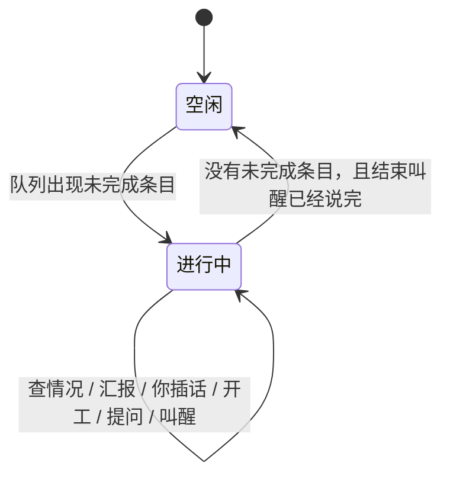

# Bot

Jarvis 里的 Bot 是长期运行的主代理。它不属于任何一个项目，只负责拆任务、盯进度、查情况、汇报和提问。实际的活由工人做。

本文是实现方案，不是已完成功能。和「在某个工作区里建一条会话当 Bot」的草稿不是同一件事。实现时以本文为准。

## 目标

你把长任务、混在一起的多件事、定时任务交给一个 Bot。它长期开着，自己盯、自己查、自己处理。你和它的对话在整件事结束前都不算结束。向你确认也不能把它堵住。

不做成云电脑，也不做成外部聊天软件里的助手。

一批大约 10 到 20 条。它入队并开出几条。有一条结束或停住，主机叫醒它，由它决定开下一条、重试、跳过或问你。你随时插话。

## 体验合同

违反任何一条，就不算做成。

1. 队列里还有未完成条目，Bot 就显示进行中。模型回合结束、工具返回，都不能把它变成空闲或已完成。
2. 主代理的工具立刻返回。禁止等工人跑完。
3. 工人退出，或安静时限到达，主机叫醒主代理，并带上这一条的短结果。开下一条、重试、跳过，由主代理决定。
4. 该说话时，它必须在同一条对话里对你说，不能只改内部状态。
5. 你的消息插到汇报前面。已在跑的工人继续，除非你叫停。
6. 它问你时，工具立刻返回。未决动作不执行。已经在跑的不停。
7. 主代理不自己改文件、不自己跑那条活。实际的活只在工人里做。
8. 工人的工具过程不进主对话。你点开失败或它正在查的那一条，才能看到。
9. 会改掉你目标的动作才问：整批停、整类跳过、删数据。问出去之后，已经在跑的继续。
10. 任何确认，包括提问，都不能阻塞 Bot。未决问题只拦住那一个还没被允许的动作。

## 一批任务

1. 你把大约 10 到 20 条交给 Bot。
2. 它入队，并按并发开出几条。工具立刻返回。它不把每一条复述进对话。
3. 有一条结束。主机写下结果，叫醒 Bot，带上短结果。它说该说的，再决定要不要开下一条。
4. 你接着说「那个仓库的失败也重跑」。这是另一个作业。已在跑的不停。它决定怎么排、开不开。
5. 有一条超过安静时限。主机叫醒 Bot，并带上这一条的短过程。
6. Bot 认为要整类跳过。它写入未决问题并立刻返回。这类还没开的，它先不开。已经在跑的继续。你稍后回答，只影响这个动作。
7. 你若正在打字，你的消息先被回答。
8. 没有未完成条目。Bot 说完这一批的结果，状态才回到空闲。

## 对象

| 对象 | 职责 | 不属于 |
| --- | --- | --- |
| 主代理 | 听你的、拆任务、长期盯着、查情况、汇报、问你 | 任何一个项目 |
| 作业 | 你交来的一件事，下面有多条 | 模型上下文 |
| 条目 | 一条具体的活 | 会话列表 |
| 工人 | 在指定项目里做一条，做完就结束 | 会话列表 |
| 笔记 | 职责、固定做法 | 进度账本 |
| 未决问题 | 还没被允许的那一个动作 | 锁 |
| 定时 | 到点叫醒它来排 | 项目会话 |

进度以队列为准。笔记不记「已经跑了多少」。

### 主代理

```ts
interface BotRecord {
  id: string;
  name: string;
  job: string;
  createdAt: string;
  sessionFile: string;
  notesFile: string;
}
```

`name` 最多 40 字。`job` 最多 200 字。这是职责，不是一篇说明。

### 作业

```ts
interface BotJob {
  id: string;
  botId: string;
  title: string;
  state: "running" | "paused" | "done" | "stopped";
  concurrency?: number;
  quietMs: number;
  createdAt: string;
  stoppedAt?: string;
}
```

`stopped` 是你叫停的。重启后不复活。`paused` 是暂时拒绝开工。已在跑的不停，除非同时叫停工人。`done` 表示它的条目都已 `done`、`failed`、`skipped` 或 `interrupted`，且没有重新入队。

### 条目

```ts
interface BotItem {
  id: string;
  jobId: string;
  botId: string;
  workspaceId: string;
  title: string;
  prompt: string;
  state: "queued" | "running" | "failed" | "done" | "skipped" | "interrupted";
  attempt: number;
  quietMs: number;
  result?: string;
  error?: string;
  workerId?: string;
  startedAt?: string;
  lastOutputAt?: string;
  endedAt?: string;
}
```

`prompt` 是给工人的任务正文，最多 8000 字。`result` 是工人交回的结论，最多 1000 字。超长在写入时截断，并标明截断。截断的原文留在工人日志里，不进主对话。

未完成条目是 `queued` 和 `running`。

### 工人

```ts
interface BotWorker {
  id: string;
  itemId: string;
  botId: string;
  pid?: number;
  sessionFile: string;
  logFile: string;
  state: "starting" | "running" | "exited" | "killed";
  startedAt: string;
  endedAt?: string;
  exitCode?: number;
}
```

工人是一次性的。进程结束，记录留下，供失败时点开。不进入任何项目的会话列表。

### 未决问题

```ts
interface BotQuestion {
  id: string;
  botId: string;
  action: "stop-job" | "skip-class" | "delete-data" | "remember-rule";
  payload: unknown;
  text: string;
  createdAt: string;
  resolvedAt?: string;
  resolution?: "accepted" | "rejected" | "cancelled";
}
```

`text` 是它在对话里问你的那一句。`payload` 是允许之后要执行的那个动作。未决期间不执行 `payload`。

### 定时

```ts
interface BotRoutine {
  id: string;
  botId: string;
  text: string;
  kind: "at" | "every";
  at?: string;
  everyMs?: number;
  nextRunAt: string;
}
```

到点叫醒模型，由它决定怎么排。`every` 最短 5 分钟。`at` 是一次，触发后删除。

## 文件

```text
~/.jarvis/bots.json
~/.jarvis/bots/<botId>/session.jsonl
~/.jarvis/bots/<botId>/notes.md
~/.jarvis/bots/<botId>/workers/<workerId>.jsonl
~/.jarvis/bots/<botId>/workers/<workerId>.log
```

`bots.json` 放 Bot 记录、作业、条目、定时、未决问题、运行时配置。笔记不放进这个文件。写入用临时文件换名。

工人的会话文件和日志不放进项目的会话目录。工作目录才是目标项目。这样项目会话列表、清理、搜索都不会扫到工人。

## 权限

主代理能看所有已登记工作区的路径、名称、最近会话、是否在跑。能看任何一个工人的状态和短过程。能改自己的队列。

它不能改文件，不能跑命令，不能读未登记目录，不能读另一个 Bot 的笔记或会话。

工人在该条目标记的项目里可以读、改、跑命令。路径必须落在该项目根目录内。未登记目录拒绝。

删数据、丢掉整批、把一条新规矩写入笔记，走未决问题。查看、重试、换工人、跳过还没开的、改并发、暂停开工，不需要你逐步批准。

## 状态



没有「等你」状态。未决问题挂在进行中旁边。

Bot 的界面状态不看模型这一轮有没有结束。有未完成条目，就是进行中。最后一条结束后，结束叫醒的回合还在进行时，也是进行中。这个回合结束，且没有未完成条目，才离开进行中。

| 队列 | 界面 |
| --- | --- |
| 有 `queued`、`running` | 进行中 |
| 没有未完成条目，结束叫醒还没说完 | 进行中 |
| 没有未完成条目，最后一批有失败，结果已说完 | 失败，可点开 |
| 没有未完成条目，也没有失败，结果已说完 | 空闲 |
| 作业是 `stopped` | 空闲，条目保留 |

模型回合结束、工具返回、派出工人，都不能把仍有未完成条目的进行中改成已完成。

## 主机

调度器在 Jarvis 进程里。服务 `start()` 时启动，`onClose` 时停掉自己拉起的工人。不放进 Pi 扩展。扩展会随会话关掉。

主机做这些事，不经过模型：

- 按主代理的开工调用拉起工人
- 看进程是否退出、是否被杀掉
- 进程退出时写下结果，叫醒主代理
- 看 `lastOutputAt` 是否超过 `quietMs`，到了就叫醒
- 合并叫醒，到点送进主代理对话
- 关闭时杀掉自己拉起的工人

工具返回前不能出现对工人结束的等待。

### 安静时限

`lastOutputAt` 在工人日志有新输出时更新。超过 `quietMs` 仍无新输出，视为停住。

默认 `quietMs` 是 30 分钟，避免慢任务被误判。你说了更短，入队时改这一条或这一作业。不能短于 1 分钟。

停住不标失败，也不杀掉进程。主机叫醒主代理，带上这一条的短过程。

### 叫醒

叫醒是给主代理送一条后续消息，并让它再跑一轮。消息不直接显示成系统说明。用户看到的是它说出来的话。这一轮它也可以只开工，不另说一句。

这些情况产生一次叫醒：

- 你发了消息。这不是叫醒，是插队。
- 一条工人退出
- 一条停住
- 定时到点
- 启动时发现中断条目

没有未完成条目时，叫醒内容里标明这一批已经做完。这一轮它要把结果说出来。

主代理正忙时，多条叫醒合成一条后续，不排成一串汇报。合成内容仍是短状态，加上这次结束或停住的条目，最多 5 条。其余只进数量。你的消息不参与合成，单独插到前面。

短状态只有：

```text
在跑 2
待做 7
失败 1
中断 0
未决 0
结束 item-3 成功
要查 item-5 已 41 分钟无输出
```

结束的条目带 `result` 或 `error`。停住的条目带短过程。不附带工人工具过程。

### 重启

启动时读 `bots.json`。

- 作业是 `running` 或 `paused`：恢复监督。`running` 的条目标成 `interrupted`，不增加 `attempt`，不拉起工人。
- 作业是 `stopped`：不拉起工人。
- 作业是 `done`：不动。
- 有条目被标成 `interrupted` 时，叫醒对应 Bot，告诉它是哪些。这一句仍然由它来说。要不要重试、开不开，由它决定。

Jarvis 没开着，队列不跑。没有云端续跑。

## 主代理会话

不调用 `SessionService.create(workspaceId)`。那会进项目列表，也会带上改文件和跑命令。

单独 `createAgentSession`：

- 目录是 `~/.jarvis/bots/<id>/`
- 会话文件是该目录下的 `session.jsonl`
- `excludeTools` 去掉 `bash`、`edit`、`write`、`powershell`
- 不注册项目后台命令工具
- 只注册本文的 Bot 工具

接口是 `/api/bots`。客户端复用现有时间线。流的事件形状与会话流相同，身份是 `botId`，不是 `workspaceId + sessionId`。

现有 `SessionRef` 必须带 `workspaceId`。不能造一个隐藏项目来装 Bot。隐藏项目会漏进侧边栏、清理和文件树。

注意力状态由调度器写，不由模型回合写。有未完成条目，或结束叫醒还没说完，就是 `running`。没有，且存在未打开的失败，就是 `failed`。否则 `idle`。

## 工具

每个工具都是同步改队列或读一段已经存在的数据，然后返回。实现里禁止 `await` 工人退出，禁止等用户消息，禁止等下一次叫醒。

| 工具 | 作用 | 立刻返回 |
| --- | --- | --- |
| `enqueueItems` | 提交最多 20 条，写成作业和条目。不拉起工人 | `{ accepted, jobId, count }` |
| `start` | 开指定的 `queued` 条目，或按入队顺序开若干条 | `{ started, pending }` |
| `setConcurrency` | 改一个作业的并发。不拉起工人 | `{ concurrency }` |
| `pause` | 这个作业拒绝开工。已在跑的不停 | `{ paused: true }` |
| `resume` | 允许这个作业再开工。不拉起工人 | `{ paused: false }` |
| `retry` | 把失败或中断条目改回 `queued`。不拉起工人 | `{ queued }` |
| `skip` | 把还没在跑的条目标成 `skipped` | `{ skipped }` |
| `replaceWorker` | 杀掉这一条的进程，再为它拉起一个工人 | `{ started }` 或 `{ queued }` |
| `inspect` | 读一条的状态和短过程 | `{ state, result, excerpt }` |
| `ask` | 写入未决问题 | `{ accepted, questionId }` |
| `writeNotes` | 整份替换笔记 | `{ written: true }` 或上限错误 |
| `schedule` | 添加定时 | `{ routineId, nextRunAt }` |
| `unschedule` | 取消定时 | `{ removed: true }` |

`inspect` 的 `excerpt` 是日志最后 80 行，且最多 4000 字。再早的内容不进这一次工具结果。用户在界面点开时可以看完整日志，那次阅读不进模型上下文。

`enqueueItems` 每条有 `workspaceId`、`prompt`。`title` 可缺，缺了取 `prompt` 前 80 字。超过 20 条整次拒绝。工作区未登记，整次拒绝，不创建半截作业。`concurrency` 可缺。

`start` 只开 `queued`。作业是 `paused` 或 `stopped` 时拒绝。作业写了 `concurrency` 时，超过这个数的仍是 `queued`。

`replaceWorker` 先杀掉当前进程，`attempt + 1`。新工人拉起了，条目是 `running`，返回 `{ started }`。没拉起，条目是 `queued`，返回 `{ queued }`。

`retry` 若把已 `done` 的作业里的条目改回 `queued`，作业改回 `running`。

`ask` 的 `action` 只允许 `stop-job`、`skip-class`、`delete-data`、`remember-rule`。其他动作不要走 `ask`。调用在问题落盘后返回，不等你回答。

`writeNotes` 只接受整份新内容。主机检查：

- 超过 8000 字，拒绝，不截断保存
- 内容像进度账本（大段条目 id、完成计数清单），拒绝
- 路径不是这个 Bot 的 `notes.md`，拒绝

你在界面改笔记，同样整份替换，同样走这个上限。

## 不阻塞

你的消息走 `steer`。汇报和自检走 `followUp`。现有 `prompt()` 在忙时默认 `followUp`，Bot 的发送路径必须改成你的消息用 `steer`。

`ask` 不是扩展确认框。扩展确认框要等返回，Bot 会堵住。禁止在 Bot 工具里调用那种等待。

未决问题只使 `payload` 不执行。已经在跑的继续。安静时限到了仍然叫醒。主代理仍可以给其他条目开工。

你的下一条消息若明确接受或拒绝那个 `questionId`，主机执行或丢掉 `payload`，然后主代理继续说话。没对上，就当普通指令，未决问题还在，Bot 也不停。

叫停整件事在你接受 `stop-job` 之前不生效。接受之后，不再开工，已在跑的杀掉，未完成条目标成 `interrupted` 并留下。不删除。

## 工人进程

工人是单独进程，不是进程内再开一个会阻塞主代理的 `AgentSession`，也不是现有的 `subagent` 工具。

Windows：

- `windowsHide: true`
- `detached: false`
- stdio 不继承控制台
- 停用 `taskkill /T /F`
- 不对 Node 使用 `detached: true`

入口走现有 Pi CLI 转发，使用 Pi 包里的 CLI，而不是 `process.argv[1]`。后者在 Jarvis 里会再启动一个服务。

启动参数：

- 工作目录是条目的项目根
- 会话文件在 `~/.jarvis/bots/<botId>/workers/<workerId>.jsonl`
- 会话号以 `worker.` 开头
- 一次只接收这一条的 `prompt`
- 结束后往 stdout 打一行固定结果：`JARVIS_BOT_RESULT ` 加 JSON，字段是 `ok` 和 `summary`

主机以这一行为结论。没有这一行，按失败处理，`error` 写「没有结论」。日志仍保留。然后叫醒主代理。

`isVisibleSessionId` 现在只拒绝 `subagent.`。要同时拒绝 `worker.`。项目会话的列表、搜索、清理都走这个判断。

一个工人崩溃只结束这一条。调度器捕获退出，写下结果或失败，叫醒主代理。不让异常冒泡到 Jarvis 进程。

## 上下文

模型每轮只有四样：职责、笔记、一份新的短状态、最近对话。

短状态在 `before_agent_start` 注入。`customType` 为 `jarvis.bot.board`，`display: false`。`agent_before_settle` 把更早的 `jarvis.bot.board` 用 `context_edit` 去掉。不写入会累积的系统提示词段。

对话满了走现有压缩。压缩不打开、不改写笔记和 `bots.json`。

时间线上能翻到的旧话，不等于模型还看得到。

## 记忆

每个 Bot 一份 `notes.md`。培养的是会反复用到的做法，不是日记。

会写入的：

- 你说的规矩。它当场整份替换，然后继续干活。
- 你在界面里改的全文。
- 你接受了 `remember-rule` 之后的那次替换。

不会写入的：

- 它自己从一次经历总结、你还没同意的规矩。它只能在对话里说。没写入也不停工。
- 完成了多少、哪些 id 失败了。
- 工人过程。
- 另一个 Bot 的话。

清空笔记要确认。清的是文件，队列还在。确认框写明笔记会清空，队列不删。

## 界面

桌面侧边栏在项目上面列 Bot。手机的会话切换里，Bot 单独成组。行上只显示名字和状态：进行中、空闲、失败。进行中可以带数量，数量是状态，不是说明。

新建只有两个字段：名字、职责。没有介绍。

Bot 页复用会话时间线。旁边是数量：待做、在跑、失败、完成、并发。点失败或正在查的条目，打开该工人日志。日志页没有讲解。

叫停要确认，写明未做完的会留下。删 Bot 要确认，写明队列、笔记和工人日志会删掉，项目文件不动。

项目会话的工具、列表、排队、清理不变。

## 接口

```text
GET    /api/bots
POST   /api/bots
GET    /api/bots/:botId
PATCH  /api/bots/:botId
DELETE /api/bots/:botId
GET    /api/bots/:botId/board
GET    /api/bots/:botId/items
GET    /api/bots/:botId/items/:itemId
GET    /api/bots/:botId/items/:itemId/log
POST   /api/bots/:botId/prompt
POST   /api/bots/:botId/jobs/:jobId/stop
GET    /api/bots/:botId/notes
PUT    /api/bots/:botId/notes
```

`prompt` 的忙时行为是 `steer`。`board` 是界面用的数量，不代替模型上下文里的短状态。`log` 只在你点开时取，不随时间线推送。

Bot 的流复用会话事件里的时间线、运行状态和排队。身份字段用 `botId`。

## 设置

运行时配置，放在 Jarvis 设置里：

| 项 | 默认 | 作用 |
| --- | --- | --- |
| 安静时限 | 30 分钟 | 条目没单独指定时使用 |
| 笔记上限 | 8000 字 | 超过拒绝写入 |
| 一次入队上限 | 20 条 | 超过整次拒绝 |
| 未完成上限 | 40 条 / Bot | 未完成条目超过这个数，整次拒绝入队 |

这些不是环境变量。

## 边界

- 入队超过一次上限或未完成上限：整次拒绝，不部分写入。
- 目标工作区已被删除：该条目标 `failed`，错误是工作区不存在。叫醒主代理。已在跑的其他条目继续。
- 工人没有打出结果行：该条 `failed`，不把 stdout 整份送进主对话。叫醒主代理。
- 模型调用了被排除的改文件或跑命令：工具不存在。它只能重新入队、开工或查看。
- 你在未决问题还在时又交了新活：新活可以入队、开工。未决动作仍不执行。
- 叫醒合成期间你发了消息：先 `steer` 你的消息。合成汇报留在后续。
- Jarvis 关闭：杀掉工人进程树。条目在下次启动时按重启规则处理。不把工人留成孤儿控制台。

## 不做

云电脑、外部聊天软件、群聊、主代理自己把活做完、通用技能库、会等待返回的确认框、把 Bot 或工人装进隐藏项目。

## 验收

不调用真模型，用假工人进程证明：

- `enqueueItems` 在工人结束前已经返回，且 `count` 等于提交条数。
- `start` 在对应工人结束前已经返回。
- 一个假工人退出后，下一条仍是 `queued`。主机写下了结果，并产生了叫醒。这段时间没有开工调用，就没有新工人。
- 忙时提交的用户消息是 `steer`，汇报是 `followUp`。
- `ask` 返回时未决问题已写入，对应 `payload` 未执行，已在跑的工人仍在跑。
- 安静时限到达后，叫醒内容里有该条短过程，且短过程不超过 4000 字。这一条的进程还在。
- 主代理工具列表没有 `bash`、`edit`、`write`。
- 项目会话 `list()` 不包含 Bot 会话，也不包含 `worker.`。
- 重启后，原先 `running` 的条目标成 `interrupted`，没有工人被拉起，对应 Bot 有叫醒。`stopped` 作业没有工人被拉起。
- 有未完成条目时，界面状态不是空闲或已完成。结束叫醒的回合结束前，也不是空闲或已完成。

## 实现顺序

1. 调度器、`bots.json`、入队、开工、进程退出写下结果并叫醒。这一步用假工人测。
2. 主代理会话和工具。工具全部立刻返回。`steer` / `followUp` 分开。
3. 叫醒合成、`ask` 不阻塞、进行中状态不随模型回合结束而消失。
4. 安静时限、短过程、界面数量、点开日志。
5. 定时。到点叫醒。

第 1 到第 3 步做完，一批大约 20 条才算能用。前面没有这三步，不做界面装饰。
