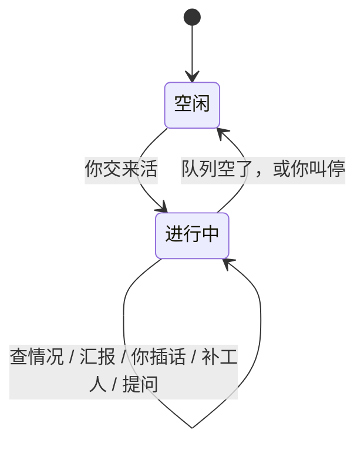

# Bot

Jarvis 里的 Bot 是长期运行的主代理。它不属于任何一个项目，只负责拆任务、盯进度、查情况、汇报和提问。实际的活由工人做。

本文是实现方案，不是已完成功能。现有未提交的协作草稿与此方案相反，实现时整段丢掉，不在上面改。

## 目标

你把长任务、混在一起的多件事、定时任务交给一个 Bot。它长期开着，自己盯、自己查、自己处理。你和它的对话在整件事结束前都不算结束。向你确认也不能把它堵住。

不做成云电脑，也不做成外部聊天软件里的助手。

## 体验合同

违反任何一条，就不算做成。

1. 队列里还有活，Bot 就显示进行中。派出工人之后不能变成空闲或已完成。
2. 主代理的工具立刻返回。禁止等工人跑完。
3. 空出的名额由主机马上补上，不由模型再发一次「再开一个」。
4. 该说话时，它必须在同一条对话里对你说，不能只改内部状态。
5. 你的消息插到汇报前面。工人继续跑，除非你叫停。
6. 它问你时，默认不停工人，也不停自己。只有问题本身是「要不要停」才停该动作。
7. 主代理不自己改文件、不自己跑那条活。实际的活只在工人里做。
8. 工人的工具过程不进主对话。你点开失败或它正在查的那一条，才能看到。
9. 活还在跑，它就自己查，不等你来问。跑得久的，它主动看有没有停住。
10. 笔记里允许的恢复，它直接做：重试、换工人、调并发。不每一步都问。
11. 会改掉你目标的动作才问：整批停、整类跳过、删数据。问出去之后，Bot 继续跑。
12. 任何确认，包括提问，都不能阻塞 Bot。未决问题只拦住那一个还没被允许的动作。

## 用法

侧边栏项目上面是 Bot。新建只填名字和职责，不选工作区。点开是一条独立对话，复用现有时间线和输入框。

你把几件事混着说。它拆成队列，定每件事开几个工人，然后留在对话里。跑完一段、有人停住、它查完一条跑得太久的，它自己开口。你问「怎么样了」，它马上用当前数量回答。

1000 条联调是 1000 个队列条目，不是 1000 个同时存在的模型进程。池子保持你要的并发，完成一条补一条。停掉的按笔记处理。你中途再说另一件事，这是新作业，下一空位就给它，不被前一批堵死。

定时到点，也是往队列加活，或叫醒它来排。不是它自己去做。

工人不是 Bot。你建的是主代理。两件要分开盯的长任务，再另建一个主代理。

## 对象

| 对象 | 职责 | 不属于 |
| --- | --- | --- |
| 主代理 | 听你的、拆任务、长期盯着、查情况、汇报、问你 | 任何一个项目 |
| 作业 | 你交来的一件事，下面有多条 | 模型上下文 |
| 条目 | 一条具体的活 | 会话列表 |
| 工人 | 在指定项目里做一条，做完就结束 | 会话列表 |
| 笔记 | 职责、固定做法、它被允许自己决定的事 | 进度账本 |
| 未决问题 | 还没被允许的那一个动作 | 锁 |

进度以队列为准。笔记不记「已经跑了多少」。

条目状态：`queued`、`running`、`retrying`、`failed`、`done`、`skipped`、`interrupted`。

作业状态：`running`、`paused`、`done`、`stopped`。`stopped` 是你叫停的，重启后不复活。

## 权限

主代理的权限高在监督，不在自己把活做了。

它能看所有已登记工作区，能看任何一个工人的状态和过程摘要，能改队列：重试、换人、改并发、置顶、暂停、继续。这些不用你逐步批准。

它没有通用的改文件和跑命令。有了这两样，它会自己去做那一批活，主对话会被撑满。

工人在该条活指定的项目里权限是满的：读、改、跑命令。范围只限那一个已登记项目。没登记进 Jarvis 的目录，两边都不能碰。

删数据、丢掉整批未做完的活，先写成未决问题。该动作不做，其他条目照常跑。

## 状态

没有「等你」这种会让 Bot 停住的状态。未决问题挂在进行中旁边。你回答之前，它不执行那个被拦住的动作，但继续盯、继续查、继续补工人。

模型某一轮生成结束，只是内部的事。界面不能因此变成已完成。

## 主机和模型

调度器放在 Jarvis 进程里，不放进 Pi 扩展。扩展会随会话关掉，撑不住长期运行。

主机持有队列、工人池、定时器、笔记文件和未决问题。Jarvis 一开就在。它负责：

- 拉起工人
- 一个工人结束或停掉后立刻补下一条
- 看进程是否退出
- 看一条是不是太久没有进展
- 按笔记做恢复
- 把结果写回条目
- 到点叫醒主代理

这些不经过模型。模型没被叫醒，下一条也可以已经在跑。

模型只在这些时候被叫醒，并且必须对你说话，或者先查再说话：

- 你发了消息
- 完成数跨过一段。默认每完成 5% 或 20 条，取更大的那个
- 一条跑得超过它自己的安静时限
- 自动恢复之后仍失败
- 笔记覆盖不了、而且会改变目标的决定
- 进行中连续 5 分钟没跟你说过话
- 定时到点

叫醒时只给短状态：在跑、待做、失败、中断的数量，未决问题，以及这次要查的几条。不给全量清单，不把工人的工具过程整份塞进上下文。它要细节，再查一条。

你的消息用插队（`steer`）。汇报和自检用后续（`followUp`）。现有 `prompt()` 在会话忙时默认 `followUp`，Bot 必须改掉这条默认。

## 不阻塞

所有主代理工具禁止等待工人、等待你的回答、等待下一次汇报。

向你确认是写入一条未决问题，工具立刻返回已接受。不能用会等返回的扩展确认框。

你的回答以后作为普通消息进来。对上那条未决问题就采用，没对上也继续跑。未决问题过期或被你明确取消，只丢掉那个动作。

叫停整件事是唯一让队列停下来的确认。在你确认之前，工人继续。确认之后，未做完的条目留下，不删除。

## 自主检查

每条活有安静时限。你没说，默认从宽，避免慢的联调被误判。入队时可以按你的话改短。

调度器用定时器看「太久没有进展」。到点不先等模型，先按笔记处理。笔记允许换工人，就换。笔记没写，就把这一条的短过程交给主代理。

短过程是状态、最后几行、退出码。不是整份日志。主代理查看一条时也是一次一段。

跑得久不是错误。主机只负责把「这条太久没进展」交出去。主代理先看摘要，再决定继续等、换工人，还是问你。这个检查是它自己发起的。

笔记允许的恢复如果已经由主机做完，叫醒模型是为了告诉你，不是为了亲自点下一次重试。模型回合慢，恢复也不能跟着慢。

## 多任务

每件你交来的事是一个作业，下面有多条。所有作业共用一个工人池。空位按作业轮流给，新作业至少能拿到下一个空位。你说「先做这件」，那件排到前面。

并发是你对这件事说的数，不能超过总上限。总上限放在 Jarvis 设置里，默认按机器来，不写死，也能调高。1000 是队列长度。

## 上下文

模型每轮只有四样：职责、笔记、刚才那份短状态、最近对话。

短状态在 `before_agent_start` 注入，`customType` 固定，`display: false`。`agent_before_settle` 把更早的同类型条目从模型上下文里去掉。不把状态写进会累积的系统提示词段。

对话满了走现有压缩。压缩不改笔记，不改队列。时间线上能翻到更早的话，不代表模型还看得到。

完整清单只在界面上。模型要用再查。

## 记忆

每个 Bot 只培养自己的一份笔记。别的 Bot 读不到。队列进度、工人过程、别的 Bot 的话，写入时就拒绝。

新建时，笔记里只有你填的职责。之后只收会反复用到的做法，比如「停住就换工人」「这类失败不用问我」。

你说了规矩，它当场整份改写笔记，然后继续干活，不等你确认。你改口或直接改文件，也是整份替换。它自己从一次经历里总结出的新规矩，先在对话里说，你没同意就不写入。没写入也不停工。

文件有上限，默认 8000 字。培养是把规矩改短、改准，不是追加日志。超了就写失败，不截断保存。写入用临时文件换名。压缩和重启不读改这个文件。另一个 Bot 的目录不在工具参数里，路径对不上就拒绝。清空要确认，清的是笔记，队列还在。

## 崩溃和重启

Jarvis 开着，工人停了由主机按笔记处理，并由主代理接着盯。一个工人进程崩了，不能带走 Jarvis 或主代理。

Jarvis 退出再开：读回 `bots.json`。进行中的作业恢复监督，中断的条目重新入队，并叫醒主代理说继续了多少。状态是叫停的，不入队，不复活。

## 界面

Bot 页就是这条对话，旁边是数量：待做、在跑、失败、完成、并发。这是给你看的，不整份塞给模型。正在查的或失败的条目可以点开过程。

没有介绍文案。新建只有名字和职责。叫停的确认框写明未做完的会留下。

项目会话不加这些工具，列表、排队和清理都不变。手机端的会话切换里，Bot 单独成组，不混进项目。

## 实现

### 会话

主代理不调用 `SessionService.create(workspaceId)`。那会进项目列表，也会带上项目的改文件和跑命令工具。

单独 `createAgentSession`，目录是 `~/.jarvis/bots/<id>/`。工具只注册：入队、改并发、置顶、暂停、继续、重试、换工人、查看一条、改笔记、定时。`excludeTools` 去掉 `bash`、`edit`、`write`。接口是 `/api/bots`。

现有 `SessionRef` 必须带 `workspaceId`。不能伪装成一个隐藏项目，否则侧边栏、清理、文件树都会漏。客户端复用时间线组件，流接在 Bot 接口上，不另做一套消息渲染。

进行中时，注意力状态强制为 `running`。模型这一轮结束，不能把它改成空闲或已完成。队列空了，或你叫停了，才改回去。

### 工人

工人是单独进程。Windows 上 `windowsHide: true`，`detached: false`，stdio 不继承控制台。停的时候用 `taskkill /T`。不能对 Node 用 `detached: true`。

入口必须走现有的 Pi CLI 转发。嵌在 Jarvis 里的进程如果用 `process.argv[1]` 派子进程，会再启动一个 Jarvis。

会话文件放在 `~/.jarvis/bots/<botId>/workers/`。工作目录才是目标项目。不要写进项目的会话目录。会话号用 `worker.` 开头。`isVisibleSessionId` 现在只藏 `subagent.`，要一起藏。

做完只回一句结论和成败。现有 `subagent` 工具会等整批结束，并把过程堆回调用方。不用它。

### 调度器

调度器在服务 `start()` 时启动，`onClose` 时停掉自己拉起的工人。队列、作业、定时、未决问题原子写入 `~/.jarvis/bots.json`。笔记不写进这个文件。

补位代码不能放在模型工具里面。工具返回前不能出现对工人结束的等待。

### 设置

总并发上限是 Jarvis 运行时配置，不放环境变量。默认按机器来，可以调高。单条安静时限和单个作业的并发由入队参数决定，受总上限约束。

## 不做

云电脑、外部聊天软件、群聊、主代理自己把活做完、1000 个同时存在的模型进程、通用技能库、会等待返回的确认框。

## 验收

不调用真模型也能证明：

- 入队后工具已返回，工人还没结束。
- 一个工人结束，下一条已启动，中间没有模型回合。
- 你的消息先于汇报。
- 提问的调用在写入未决问题后立即返回，工人仍在跑。
- 一条超过安静时限，主代理被叫醒，而且能查到那一条的短过程。
- 笔记允许的恢复不会先问你，也不等模型回合。
- 主对话里没有工人的整份工具过程。
- 主代理会话不在任何项目的 `list()` 里。工人会话不在项目会话列表里。
- 重启后进行中的作业还在监督，叫停过的没有自己复活。
- 进行中不会显示已完成。

## 实现顺序

1. 丢掉与此方案相反的未提交协作草稿。
2. 主代理会话、队列、工人池、做完就补、笔记允许的恢复。
3. 同一条对话里的汇报、提问、你插话优先。提问不阻塞。
4. 跑得久的主动检查、失败可点开、状态数量。
5. 定时任务，到点入队。

第 2、3 步做完，长任务才算能用。前面没有这两步，不做界面装饰。
