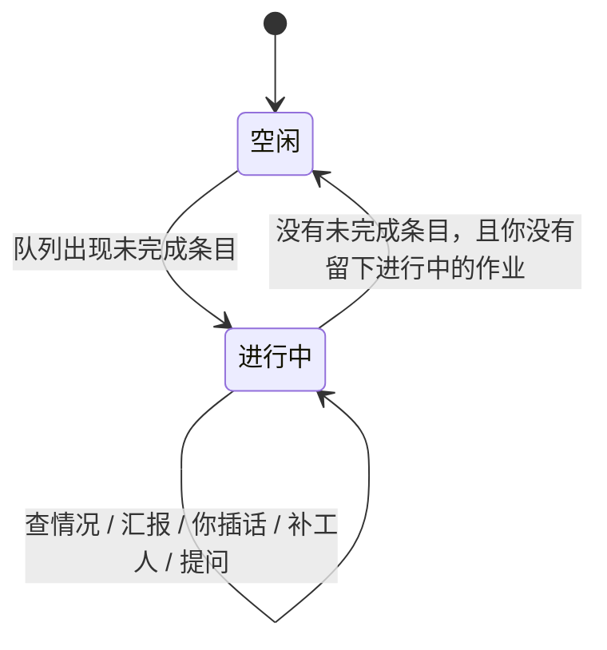

# Bot

Jarvis 里的 Bot 是长期运行的主代理。它不属于任何一个项目，只负责拆任务、盯进度、查情况、汇报和提问。实际的活由工人做。

本文是实现方案，不是已完成功能。和「在某个工作区里建一条会话当 Bot」的草稿不是同一件事。实现时以本文为准。

## 目标

你把长任务、混在一起的多件事、定时任务交给一个 Bot。它长期开着，自己盯、自己查、自己处理。你和它的对话在整件事结束前都不算结束。向你确认也不能把它堵住。

不做成云电脑，也不做成外部聊天软件里的助手。

1000 条联调是这个方案要接住的用法：队列里放 1000 条，池子保持并发，完成一条补一条，跑得久的自己查，停住的按笔记处理，你随时插话。

## 体验合同

违反任何一条，就不算做成。

1. 队列里还有活，Bot 就显示进行中。派出工人之后不能变成空闲或已完成。
2. 主代理的工具立刻返回。禁止等工人跑完。
3. 空出的名额由主机马上补上，不由模型再发一次「再开一个」。
4. 该说话时，它必须在同一条对话里对你说，不能只改内部状态。
5. 你的消息插到汇报前面。工人继续跑，除非你叫停。
6. 它问你时，默认不停工人，也不停自己。只有问题本身是「要不要停」才停该动作。
7. 主代理不自己改文件、不自己跑那条活。实际的活只在工人里做。
8. 工人的工具过程不进主对话。你点开失败或它正在查的那一条，才能看到。
9. 活还在跑，它就自己查，不等你来问。跑得久的，它主动看有没有停住。
10. 笔记里允许的恢复，主机直接做。不每一步都问，也不等模型回合。
11. 会改掉你目标的动作才问：整批停、整类跳过、删数据。问出去之后，Bot 继续跑。
12. 任何确认，包括提问，都不能阻塞 Bot。未决问题只拦住那一个还没被允许的动作。

## 一次 1000 条联调

1. 你对 Bot 说：按这个清单做，尽量开满并发。清单是某个项目里的文件。
2. 它调用一次入队，参数是工作区、文件路径、并发。工具读文件，写成 1000 条，立刻返回 `{ accepted, jobId, count }`。它不把 1000 条复述进对话。
3. 主机按总上限拉起工人。一个进程退出，主机在同一个回调里取下一条并拉起。中间没有模型回合。
4. 你接着说「那个仓库的失败也重跑」。这是第二个作业。下一个空位给它，不被前 1000 条独占。
5. 有一条超过安静时限。笔记写了「停住就换工人」，主机换人，之后才叫醒 Bot 告诉你。笔记没写，主机不猜，叫醒 Bot，并带上这一条的短过程。
6. Bot 认为要整类跳过。它写入未决问题并立刻返回。这类条目先不动。其他条目继续跑。你稍后回答，只影响这个动作。
7. 完成数跨过一段，或连续 5 分钟没说过话，Bot 在同一条对话里报数量。你若正在打字，你的消息先被回答。
8. 队列空了，Bot 说完这一批的结果，状态才回到空闲。

## 对象

| 对象 | 职责 | 不属于 |
| --- | --- | --- |
| 主代理 | 听你的、拆任务、长期盯着、查情况、汇报、问你 | 任何一个项目 |
| 作业 | 你交来的一件事，下面有多条 | 模型上下文 |
| 条目 | 一条具体的活 | 会话列表 |
| 工人 | 在指定项目里做一条，做完就结束 | 会话列表 |
| 笔记 | 职责、固定做法、它被允许自己决定的事 | 进度账本 |
| 未决问题 | 还没被允许的那一个动作 | 锁 |
| 定时 | 到点入队，或到点叫醒它来排 | 项目会话 |

进度以队列为准。笔记不记「已经跑了多少」。

### 主代理

```ts
interface BotRecord {
  id: string;
  name: string;
  job: string;
  createdAt: string;
  sessionFile: string;
  notesFile: string;
}
```

`name` 最多 40 字。`job` 最多 200 字。这是职责，不是一篇说明。

### 作业

```ts
interface BotJob {
  id: string;
  botId: string;
  title: string;
  state: "running" | "paused" | "done" | "stopped";
  concurrency: number;
  pinned: boolean;
  quietMs: number;
  createdAt: string;
  stoppedAt?: string;
}
```

`stopped` 是你叫停的。重启后不复活。`paused` 是暂时不发新工人，已在跑的不停，除非同时叫停工人。`done` 表示它的条目都已 `done`、`failed`、`skipped` 或 `interrupted` 且没有重新入队。

### 条目

```ts
interface BotItem {
  id: string;
  jobId: string;
  botId: string;
  workspaceId: string;
  title: string;
  prompt: string;
  state: "queued" | "running" | "retrying" | "failed" | "done" | "skipped" | "interrupted";
  attempt: number;
  quietMs: number;
  result?: string;
  error?: string;
  workerId?: string;
  startedAt?: string;
  lastOutputAt?: string;
  endedAt?: string;
}
```

`prompt` 是给工人的任务正文，最多 8000 字。`result` 是工人交回的结论，最多 1000 字。超长在写入时截断，并标明截断。截断的原文留在工人日志里，不进主对话。

### 工人

```ts
interface BotWorker {
  id: string;
  itemId: string;
  botId: string;
  pid?: number;
  sessionFile: string;
  logFile: string;
  state: "starting" | "running" | "exited" | "killed";
  startedAt: string;
  endedAt?: string;
  exitCode?: number;
}
```

工人是一次性的。进程结束，记录留下，供失败时点开。不进入任何项目的会话列表。

### 未决问题

```ts
interface BotQuestion {
  id: string;
  botId: string;
  action: "stop-job" | "skip-class" | "delete-data" | "remember-rule";
  payload: unknown;
  text: string;
  createdAt: string;
  resolvedAt?: string;
  resolution?: "accepted" | "rejected" | "cancelled";
}
```

`text` 是它在对话里问你的那一句。`payload` 是允许之后要执行的那个动作。未决期间不执行 `payload`。

### 定时

```ts
interface BotRoutine {
  id: string;
  botId: string;
  text: string;
  kind: "at" | "every";
  at?: string;
  everyMs?: number;
  nextRunAt: string;
  jobTemplate?: {
    workspaceId: string;
    listFile: string;
    concurrency: number;
  };
}
```

有 `jobTemplate` 的，到点由主机直接入队，不先等模型。只有一句 `text` 的，到点叫醒模型，由它决定怎么排。`every` 最短 5 分钟。`at` 是一次，触发后删除。

## 文件

```text
~/.jarvis/bots.json
~/.jarvis/bots/<botId>/session.jsonl
~/.jarvis/bots/<botId>/notes.md
~/.jarvis/bots/<botId>/workers/<workerId>.jsonl
~/.jarvis/bots/<botId>/workers/<workerId>.log
```

`bots.json` 放 Bot 记录、作业、条目、定时、未决问题、运行时配置。笔记不放进这个文件。写入用临时文件换名。

工人的会话文件和日志不放进项目的会话目录。工作目录才是目标项目。这样项目会话列表、清理、搜索都不会扫到工人。

## 权限

主代理能看所有已登记工作区的路径、名称、最近会话、是否在跑。能读这些工作区里的文件，用来入队和查看。能看任何一个工人的状态和短过程。能改自己的队列。

它不能改文件，不能跑命令，不能读未登记目录，不能读另一个 Bot 的笔记或会话。

工人在该条目标记的项目里可以读、改、跑命令。路径必须落在该项目根目录内。未登记目录拒绝。

删数据、丢掉整批、把一条新规矩写入笔记，走未决问题。查看、重试、换工人、改并发、置顶、暂停发新工人，不需要你逐步批准。

## 状态



没有「等你」状态。未决问题挂在进行中旁边。

Bot 的界面状态只看队列，不看模型这一轮有没有结束。

| 队列 | 界面 |
| --- | --- |
| 有 `queued`、`running`、`retrying` | 进行中 |
| 没有未完成条目，最后一批有失败 | 失败，可点开 |
| 没有未完成条目，也没有失败 | 空闲 |
| 作业是 `stopped` | 空闲，条目保留 |

模型回合结束、工具返回、派出工人，都不能把进行中改成已完成。

## 主机

调度器在 Jarvis 进程里。服务 `start()` 时启动，`onClose` 时停掉自己拉起的工人。不放进 Pi 扩展。扩展会随会话关掉。

主机做这些事，不经过模型：

- 拉起工人
- 进程一退出，立刻取下一条并拉起
- 看进程是否退出、是否被杀掉
- 看 `lastOutputAt` 是否超过 `quietMs`
- 笔记允许时换工人或重试
- 把结论写回条目
- 合并叫醒，到点送进主代理对话

补位放在工人退出回调里，不放在模型工具里。工具返回前不能出现对工人结束的等待。

### 并发

所有 Bot 共用一个进程上限。放在 Jarvis 运行时配置里，不放环境变量。默认 `min(可用并行度, 8)`，可以调高。这是保护机器的上限，不是产品功能上限。

一个作业的 `concurrency` 不能超过这个上限。多个作业、多个 Bot 同时在跑时，实际在跑的工人数也不能超过这个上限。

### 补位

空位出现时，按下面顺序取下一条 `queued`：

1. `pinned` 的作业优先。多个置顶，按置顶时间。
2. 其余作业轮流。新作业如果还没有跑过条目，排到下一个空位，不被老作业独占。
3. 同一作业内按入队顺序。

作业是 `paused` 或 `stopped` 的，不取它的条目。`running` 的工人不因为置顶被杀掉。置顶只影响下一个空位给谁。

### 安静时限

`lastOutputAt` 在工人日志有新输出时更新。超过 `quietMs` 仍无新输出，视为停住。

默认 `quietMs` 是 30 分钟。联调里一条慢任务不该被误判。你说了更短，入队时改这一条或这一作业。不能短于 1 分钟。

停住不是立刻失败。先看笔记。

### 笔记允许的恢复

主机只认笔记里写明的动作，不推断。

| 笔记里有 | 主机做 |
| --- | --- |
| 停住就换工人 | 杀掉当前进程，`attempt + 1`，重新入队到队首 |
| 失败重试一次 | `attempt` 仍为 1 时重新入队；已经重试过则标 `failed` |
| 失败就跳过 | 标 `skipped`，不叫醒你确认 |

笔记没写的，主机不猜。标上需要看，并叫醒主代理，带短过程。

同一条目自动换工人最多 2 次。再停住就标 `failed`，叫醒主代理。避免笔记写了「停住就换」时无限重启。

恢复在主机里做完，再叫醒模型告诉你。模型回合慢，不能拖住这次换人。

### 叫醒

叫醒是给主代理送一条后续消息，并让它再说一句话。消息不直接显示成系统说明。用户看到的是它说出来的那句。

这些情况产生一次叫醒：

- 你发了消息。这不是叫醒，是插队。
- 完成数跨过 `max(20, ceil(作业总数 * 5%))`
- 一条停住，且笔记没有覆盖
- 自动恢复之后仍失败
- 会改变目标、笔记又没写的决定
- 进行中连续 5 分钟没有对你说过话，且这段时间有条目完成或失败
- 定时到点，且这条定时没有 `jobTemplate`

5 分钟内已经因为别的原因说过话，就不再为「太久没说话」重复开一次。

主代理正忙时，多条叫醒合成一条后续，不排成一串汇报。合成内容仍是短状态，加上这次要查的条目，最多 5 条。你的消息不参与合成，单独插到前面。

短状态只有：

```text
在跑 4
待做 860
失败 2
中断 0
未决 1
要查 item-18 已 41 分钟无输出
```

不附带 1000 行清单，不附带工人工具过程。

### 重启

启动时读 `bots.json`。

- 作业是 `running` 或 `paused`：恢复监督。`running` 和 `retrying` 的条目标成 `interrupted`，再入队到原作业队首。
- 作业是 `stopped`：不入队，不拉起工人。
- 作业是 `done`：不动。
- 读完后如果有重新入队，叫醒对应 Bot，告诉它继续了多少。这一句仍然由它来说。

Jarvis 没开着，队列不跑。没有云端续跑。

## 主代理会话

不调用 `SessionService.create(workspaceId)`。那会进项目列表，也会带上改文件和跑命令。

单独 `createAgentSession`：

- 目录是 `~/.jarvis/bots/<id>/`
- 会话文件是该目录下的 `session.jsonl`
- `excludeTools` 去掉 `bash`、`edit`、`write`、`powershell`
- 不注册项目后台命令工具
- 只注册本文的 Bot 工具

接口是 `/api/bots`。客户端复用现有时间线。流的事件形状与会话流相同，身份是 `botId`，不是 `workspaceId + sessionId`。

现有 `SessionRef` 必须带 `workspaceId`。不能造一个隐藏项目来装 Bot。隐藏项目会漏进侧边栏、清理和文件树。

注意力状态由调度器写，不由模型回合写。有未完成条目就是 `running`。没有，且存在未打开的失败，就是 `failed`。否则 `idle`。

## 工具

每个工具都是同步改队列或读一段已经存在的数据，然后返回。实现里禁止 `await` 工人退出，禁止等用户消息，禁止等下一次叫醒。

| 工具 | 作用 | 立刻返回 |
| --- | --- | --- |
| `enqueue` | 从一个已登记工作区的清单文件写成作业和条目 | `{ accepted, jobId, count }` |
| `enqueueItems` | 直接提交少量条目。超过 20 条拒绝，改走文件 | `{ accepted, jobId, count }` |
| `setConcurrency` | 改一个作业的并发，受总上限约束 | `{ concurrency }` |
| `pin` | 把作业排到下一个空位之前 | `{ pinned: true }` |
| `pause` | 不再给这个作业发新工人。已在跑的不停 | `{ paused: true }` |
| `resume` | 恢复发新工人 | `{ paused: false }` |
| `retry` | 把失败条目重新入队 | `{ queued }` |
| `replaceWorker` | 杀掉这一条的进程并重新入队 | `{ queued }` |
| `inspect` | 读一条的状态和短过程 | `{ state, result, excerpt }` |
| `ask` | 写入未决问题 | `{ accepted, questionId }` |
| `writeNotes` | 整份替换笔记 | `{ written: true }` 或上限错误 |
| `schedule` | 添加定时 | `{ routineId, nextRunAt }` |
| `unschedule` | 取消定时 | `{ removed: true }` |

`inspect` 的 `excerpt` 是日志最后 80 行，且最多 4000 字。再早的内容不进这一次工具结果。用户在界面点开时可以看完整日志，那次阅读不进模型上下文。

`enqueue` 读清单。清单是 JSON 数组，或一行一条的文本。一行就是一条的 `prompt`，`title` 取前 80 字。文件必须在已登记工作区内。读失败就返回错误，不创建半截作业。1000 条一次写入，模型不逐条调用。

`ask` 的 `action` 只允许 `stop-job`、`skip-class`、`delete-data`、`remember-rule`。其他动作不要走 `ask`。调用在问题落盘后返回，不等你回答。

`writeNotes` 只接受整份新内容。主机检查：

- 超过 8000 字，拒绝，不截断保存
- 内容像进度账本（大段条目 id、完成计数清单），拒绝
- 路径不是这个 Bot 的 `notes.md`，拒绝

你在界面改笔记，同样整份替换，同样走这个上限。

## 不阻塞

你的消息走 `steer`。汇报和自检走 `followUp`。现有 `prompt()` 在忙时默认 `followUp`，Bot 的发送路径必须改成你的消息用 `steer`。

`ask` 不是扩展确认框。扩展确认框要等返回，Bot 会堵住。禁止在 Bot 工具里调用那种等待。

未决问题只使 `payload` 不执行。调度器继续补位，继续看安静时限，继续按笔记恢复其他条目。

你的下一条消息若明确接受或拒绝那个 `questionId`，主机执行或丢掉 `payload`，然后主代理继续说话。没对上，就当普通指令，未决问题还在，Bot 也不停。

叫停整件事在你接受 `stop-job` 之前不生效。接受之后，不再发新工人，已在跑的杀掉，未完成条目标成 `interrupted` 并留下。不删除。

## 工人进程

工人是单独进程，不是进程内再开一个会阻塞主代理的 `AgentSession`，也不是现有的 `subagent` 工具。

Windows：

- `windowsHide: true`
- `detached: false`
- stdio 不继承控制台
- 停用 `taskkill /T /F`
- 不对 Node 使用 `detached: true`

入口走现有 Pi CLI 转发，使用 Pi 包里的 CLI，而不是 `process.argv[1]`。后者在 Jarvis 里会再启动一个服务。

启动参数：

- 工作目录是条目的项目根
- 会话文件在 `~/.jarvis/bots/<botId>/workers/<workerId>.jsonl`
- 会话号以 `worker.` 开头
- 一次只接收这一条的 `prompt`
- 结束后往 stdout 打一行固定结果：`JARVIS_BOT_RESULT ` 加 JSON，字段是 `ok` 和 `summary`

主机以这一行为结论。没有这一行，按失败处理，`error` 写「没有结论」。日志仍保留。

`isVisibleSessionId` 现在只拒绝 `subagent.`。要同时拒绝 `worker.`。项目会话的列表、搜索、清理都走这个判断。

一个工人崩溃只结束这一条。调度器捕获退出，按笔记恢复或标失败。不让异常冒泡到 Jarvis 进程。

## 上下文

模型每轮只有四样：职责、笔记、一份新的短状态、最近对话。

短状态在 `before_agent_start` 注入。`customType` 为 `jarvis.bot.board`，`display: false`。`agent_before_settle` 把更早的 `jarvis.bot.board` 用 `context_edit` 去掉。不写入会累积的系统提示词段。

对话满了走现有压缩。压缩不打开、不改写笔记和 `bots.json`。

时间线上能翻到的旧话，不等于模型还看得到。

## 记忆

每个 Bot 一份 `notes.md`。培养的是会反复用到的做法，不是日记。

会写入的：

- 你说的规矩。它当场整份替换，然后继续干活。
- 你在界面里改的全文。
- 你接受了 `remember-rule` 之后的那次替换。

不会写入的：

- 它自己从一次经历总结、你还没同意的规矩。它只能在对话里说。没写入也不停工。
- 完成了多少、哪些 id 失败了。
- 工人过程。
- 另一个 Bot 的话。

清空笔记要确认。清的是文件，队列还在。确认框写明笔记会清空，队列不删。

## 界面

桌面侧边栏在项目上面列 Bot。手机的会话切换里，Bot 单独成组。行上只显示名字和状态：进行中、空闲、失败。进行中可以带数量，数量是状态，不是说明。

新建只有两个字段：名字、职责。没有介绍。

Bot 页复用会话时间线。旁边是数量：待做、在跑、失败、完成、并发。点失败或正在查的条目，打开该工人日志。日志页没有讲解。

叫停要确认，写明未做完的会留下。删 Bot 要确认，写明队列、笔记和工人日志会删掉，项目文件不动。

项目会话的工具、列表、排队、清理不变。

## 接口

```text
GET    /api/bots
POST   /api/bots
GET    /api/bots/:botId
PATCH  /api/bots/:botId
DELETE /api/bots/:botId
GET    /api/bots/:botId/board
GET    /api/bots/:botId/items
GET    /api/bots/:botId/items/:itemId
GET    /api/bots/:botId/items/:itemId/log
POST   /api/bots/:botId/prompt
POST   /api/bots/:botId/jobs/:jobId/stop
GET    /api/bots/:botId/notes
PUT    /api/bots/:botId/notes
```

`prompt` 的忙时行为是 `steer`。`board` 是界面用的数量，不代替模型上下文里的短状态。`log` 只在你点开时取，不随时间线推送。

Bot 的流复用会话事件里的时间线、运行状态和排队。身份字段用 `botId`。

## 设置

运行时配置，放在 Jarvis 设置里：

| 项 | 默认 | 作用 |
| --- | --- | --- |
| 工人进程上限 | `min(可用并行度, 8)` | 所有 Bot 共用 |
| 安静时限 | 30 分钟 | 条目没单独指定时使用 |
| 汇报间隔 | 5 分钟 | 有进展又没说过话时叫醒 |
| 笔记上限 | 8000 字 | 超过拒绝写入 |
| 队列上限 | 5000 条 / Bot | 超过拒绝入队 |

这些不是环境变量。改完对已在跑的池子生效：上限调低时不杀已在跑的工人，只是不再补到新上限以上。

## 边界

- 清单文件读到一半失败：不留下半截作业。
- 入队超过队列上限：整次拒绝，不部分写入。
- 目标工作区已被删除：该条目标 `failed`，错误是工作区不存在。其他条目继续。
- 工人没有打出结果行：该条 `failed`，不把 stdout 整份送进主对话。
- 同一条目自动换人已达 2 次：标 `failed`，叫醒主代理。
- 模型调用了被排除的改文件或跑命令：工具不存在。它只能重新入队或查看。
- 两个 Bot 的并发相加超过总上限：后补的空位等总池子，不各自开满。
- 你在未决问题还在时又交了新活：新活照常入队。未决动作仍不执行。
- 叫醒合成期间你发了消息：先 `steer` 你的消息。合成汇报留在后续。
- Jarvis 关闭：杀掉工人进程树。条目在下次启动时按重启规则处理。不把工人留成孤儿控制台。

## 不做

云电脑、外部聊天软件、群聊、主代理自己把活做完、1000 个同时存在的模型进程、通用技能库、会等待返回的确认框、把 Bot 或工人装进隐藏项目。

## 验收

不调用真模型，用假工人进程证明：

- `enqueue` 在工人结束前已经返回，且 `count` 等于清单行数。
- 一个假工人退出后，下一条已启动。这段时间没有模型回合。
- 忙时提交的用户消息是 `steer`，汇报是 `followUp`。
- `ask` 返回时未决问题已写入，对应 `payload` 未执行，其他条目仍会补位。
- 笔记写了「停住就换工人」时，安静时限到达后主机换人，不等模型。
- 笔记没写时，安静时限到达后叫醒内容里有该条短过程，且短过程不超过 4000 字。
- 主代理工具列表没有 `bash`、`edit`、`write`。
- 项目会话 `list()` 不包含 Bot 会话，也不包含 `worker.`。
- 重启后 `running` 作业的中断条目重新入队，`stopped` 作业没有工人被拉起。
- 有未完成条目时，界面状态不是空闲或已完成。

## 实现顺序

1. 调度器、`bots.json`、入队、进程池、退出即补、笔记恢复。这一步用假工人测。
2. 主代理会话和工具。工具全部立刻返回。`steer` / `followUp` 分开。
3. 叫醒合成、`ask` 不阻塞、进行中状态不随模型回合结束而消失。
4. 安静时限、短过程、界面数量、点开日志。
5. 定时。有模板的直接入队，只有文本的叫醒。

第 1 到第 3 步做完，1000 条联调才算能用。前面没有这三步，不做界面装饰。
